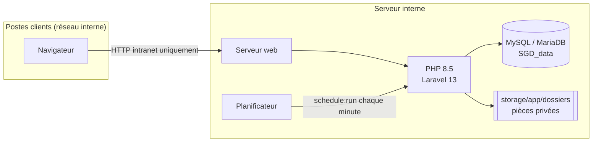
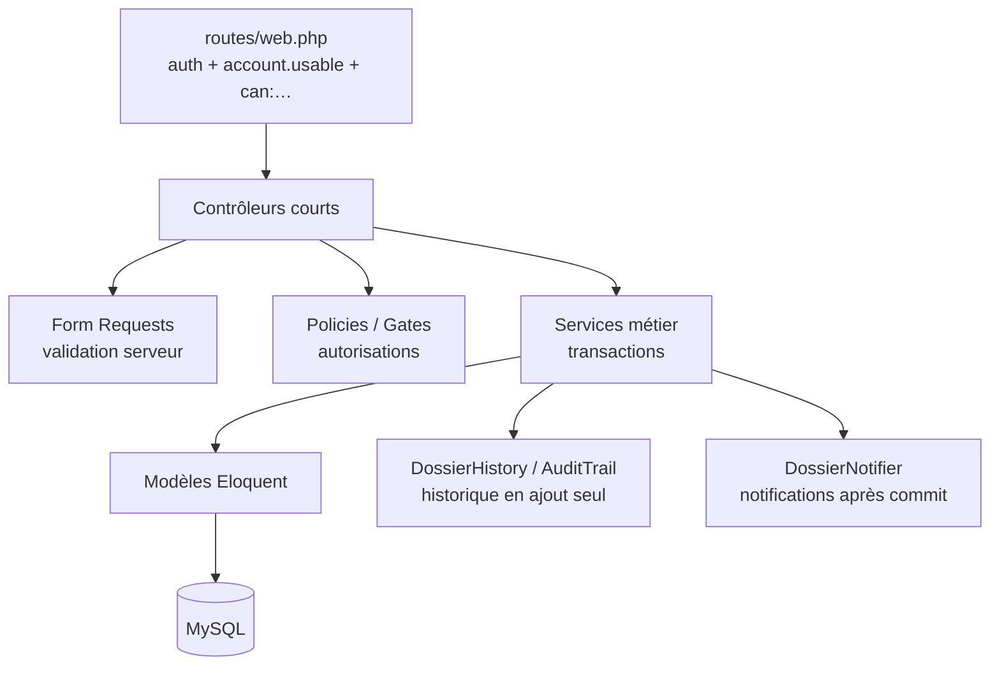

# Architecture

## Vue d'ensemble

Aucun service externe : pas de cloud, pas de CDN (polices et scripts servis localement).
Seule sortie : le serveur de messagerie de l'entreprise (`MAIL_*` dans `.env`), utilisé uniquement pour
les alertes « délai dépassé » envoyées au destinataire et à l'expéditeur.

## Couches applicatives

| Élément | Rôle | Exemples |
|---|---|---|
| **Contrôleurs** (`app/Http/Controllers`) | Recevoir la requête, autoriser, déléguer, répondre | `DossierController`, `TreatmentController`, `ExternalRequestController` |
| **Form Requests** (`app/Http/Requests`) | Valider toutes les entrées côté serveur | `StoreInternalRequest`, `StoreExternalRequest`, `RespondRequest` |
| **Policies** (`app/Policies`) | Toutes les décisions d'accès (jamais un simple bouton masqué) | `DossierPolicy`, `DocumentPolicy`, `UserPolicy`, `DepartmentPolicy`, `ResponsePolicy` |
| **Services** (`app/Services`) | Logique métier, transactions, historique, notifications | `InternalRequestService`, `TreatmentService`, `ValidationService`, `ExternalRequestService`, `DocumentService`, `ReminderService`, `HistoryExporter` |
| **Support** (`app/Support`) | Utilitaires sans état | `Navigation` (menu selon permissions), `Deadline` (libellés d'échéance) |
| **Enums** (`app/Enums`) | Statuts et listes fermées, libellés français | `DossierStatus`, `RecipientStatus`, `DocumentStatus`, `ResponseDecision` |

## Principes de conception

- **Source unique de vérité pour la visibilité** : le scope `Dossier::visibleTo()` est utilisé à la fois
  par `DossierPolicy::view` et les listes de dossiers.
- **Autorisation par permissions** : `Gate::before` relie chaque code de permission (`manage_users`…) ;
  les rôles ne sont que des paquets de permissions, modifiables sans code.
- **Traçabilité** : `DossierHistory` (historique des dossiers) et `AuditTrail` (comptes, départements,
  paramètres) sont les seuls points d'écriture ; leurs tables refusent UPDATE et DELETE par trigger.
- **Transactions** : toute opération métier (création, réponse, validation, archivage, réouverture,
  document, désactivation) est atomique ; les notifications ne partent qu'après validation (`afterCommit`).
- **Statut global déduit** : le statut d'un dossier est calculé à partir des traitements individuels
  (`DossierStatusSynchronizer`), jamais l'inverse : aucun destinataire n'écrase le statut d'un autre.
- **Stockage privé** : disque `dossiers` hors de `public/`, noms système aléatoires, type vérifié sur le contenu.
- **Performance** : pagination, chargement anticipé (eager loading), contrôles d'accès mémorisés par requête.

## Tâches planifiées

| Commande | Fréquence | Rôle |
|---|---|---|
| `dossiers:check-deadlines` | toutes les heures | Alertes « échéance aujourd'hui » et « délai dépassé », sans doublon |
