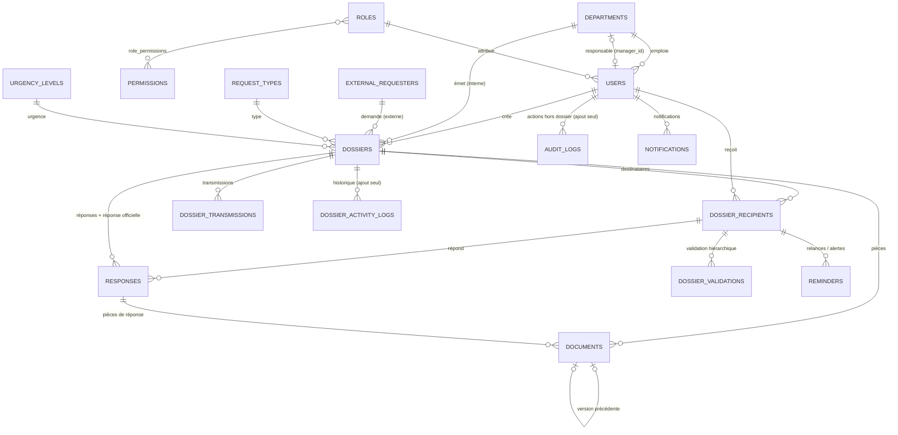

# Base de données

Base MySQL/MariaDB `SGD_data`, encodage `utf8mb4`. Toutes les modifications de schéma passent par
des **migrations** (`database/migrations`) ; aucune migration déjà exécutée n'est modifiée.

## Modèle conceptuel (MCD)



## Tables principales

| Table | Rôle | Points clés |
|---|---|---|
| `departments` | Départements (6 initiaux) | `code` et `name` uniques, `manager_id` (responsable), désactivés jamais supprimés |
| `roles`, `permissions`, `role_permissions` | Autorisations | 4 rôles, 25 permissions, association modifiable depuis l'interface |
| `users` | Comptes | `username` unique (identifiant de connexion), mot de passe haché, `is_active`, `replaces_user_id` (changement de département) |
| `request_types`, `urgency_levels` | Référentiels | portée interne/externe ; délai de réponse en heures |
| `external_requesters` | Demandeurs externes | nom, organisme, contacts |
| `dossiers` | Dossier (interne ou externe) | `reference` unique `DOS-AAAA-NNNNNN`, statut global, échéance ; contrainte CHECK origine ↔ provenance |
| `dossier_sequences` | Numérotation annuelle | verrouillée (`SELECT … FOR UPDATE`) : aucun doublon |
| `dossier_recipients` | Traitement d'un destinataire | statut **propre à chacun**, échéance, dates de lecture/réponse/archivage ; unique (dossier, utilisateur) |
| `responses` | Réponses | décision positive/négative, justification, recommandation ; réponse officielle (`is_final`, canal, date d'envoi) |
| `documents` | Pièces versionnées | `document_key` + `version` uniques, statut ACTIVE / REPLACED / CANCELLED, SHA-256 |
| `dossier_transmissions` | Envois, transmissions au responsable ou à un collègue, retours au RH | |
| `dossier_validations` | Validation hiérarchique | À valider / Validé / Refusé, commentaires |
| `reminders` | Relances manuelles et alertes automatiques | `reason` : pas deux fois la même alerte |
| `dossier_activity_logs` | **Historique des dossiers** | utilisateur, action, ancienne / nouvelle valeur, commentaire ; **triggers anti-UPDATE/DELETE** |
| `audit_logs` | Historique hors dossier | comptes, départements, paramètres ; **ajout seul** |
| `settings` | Paramètres modifiables | préfixe des numéros, porte d'entrée RH |
| `notifications` | Notifications Laravel | lu / non lu |

## Intégrité

- Clés étrangères en `RESTRICT` : impossible de supprimer un utilisateur, un département ou un dossier
  qui possède un historique — on **désactive** ou on **archive**.
- Aucune suppression physique de donnée métier n'est proposée par l'application.
- Index sur les accès fréquents : (département, statut), (statut, échéance), (utilisateur, statut),
  (dossier, date) pour l'historique.

## Commandes utiles

```bash
php artisan migrate:status
php artisan migrate --force        # production
php artisan db:seed --force        # référentiels manquants uniquement
```
