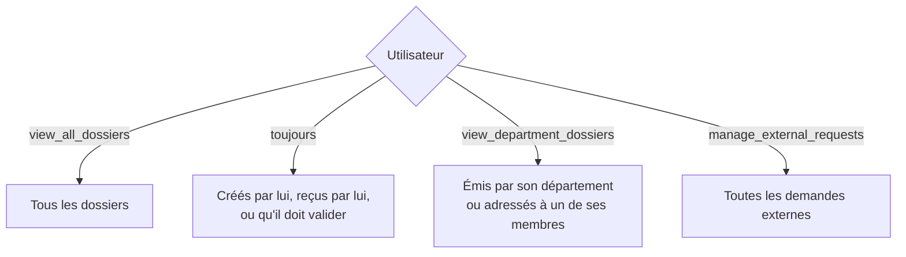

# Rôles et permissions

Les droits reposent sur des **permissions** regroupées en **rôles**. L'administrateur peut modifier
l'association rôle ↔ permissions depuis *Paramètres → Rôles et permissions* (sans toucher au code) ;
il ne peut pas retirer la gestion des permissions à son propre rôle.

Chaque contrôle est fait **côté serveur** (routes `can:…`, Policies) : masquer un bouton n'est jamais
considéré comme une sécurité. Les tests `SecurityTest` et `AuthorizationTest` vérifient notamment qu'un
utilisateur ne peut pas accéder à un dossier interdit en changeant simplement l'identifiant dans l'URL.

## Matrice par défaut

| Permission | Administrateur | RH | Responsable | Employé |
|---|:-:|:-:|:-:|:-:|
| `create_internal_request` — Créer une demande interne | ✅ | ✅ | ✅ | ✅ |
| `create_external_request` — Enregistrer une demande externe | | ✅ | | |
| `manage_external_requests` — Suivre les demandes externes, réponse officielle | | ✅ | | |
| `view_own_dossiers` — Voir ses dossiers | ✅ | ✅ | ✅ | ✅ |
| `view_department_dossiers` — Voir les dossiers de son département | | | ✅ | |
| `view_all_dossiers` — Voir tous les dossiers | ✅ | | | |
| `respond_dossier` — Répondre à un dossier | ✅ | ✅ | ✅ | ✅ |
| `transmit_dossier` — Transmettre un dossier | ✅ | ✅ | ✅ | ✅ |
| `validate_dossier` — Valider ou refuser | | | ✅ | |
| `reopen_dossier` — Réouvrir un traitement archivé | | | ✅ | |
| `archive_dossier` — Archiver un traitement | ✅ | ✅ | ✅ | ✅ |
| `send_reminder` — Relancer un destinataire | ✅ | ✅ | ✅ | ✅ |
| `view_own_history` — Historique de ses dossiers | | ✅ | ✅ | ✅ |
| `view_department_history` — Historique du département | | | ✅ | |
| `view_all_history` — Historique de tous les dossiers | | | | |
| `download_document` — Télécharger les documents autorisés | ✅ | ✅ | ✅ | ✅ |
| `manage_users` — Gérer les utilisateurs | ✅ | | | |
| `deactivate_department_user` — Désactiver un employé de son département | | | ✅ | |
| `manage_departments` — Gérer les départements | ✅ | | | |
| `manage_request_types` — Gérer les types de demandes | ✅ | | | |
| `manage_urgencies` — Gérer les niveaux d'urgence | ✅ | | | |
| `manage_permissions` — Gérer les rôles et permissions | ✅ | | | |
| `manage_settings` — Gérer les paramètres | ✅ | | | |
| `view_department_statistics` — Statistiques du département | | | ✅ | |
| `view_global_statistics` — Statistiques générales | ✅ | | | |

## Règles particulières

- **Seul le RH** enregistre une demande externe et envoie la réponse officielle.
- **L'administrateur voit les dossiers mais pas leur historique détaillé** : son rôle n'a aucune permission
  `view_*_history`. Pour changer cette règle, cocher `view_all_history` pour le rôle Administrateur.
- **Un destinataire ne lit pas les réponses des autres destinataires** ; l'expéditeur, le RH (externe)
  et les responsables des départements concernés les voient. Le même filtrage s'applique à l'historique
  affiché et aux exports.
- **Un responsable** ne désactive que les employés actifs de son propre département ; l'administration est notifiée.
- **Réouvrir un traitement** répondu ou archivé : le responsable du département du destinataire (motif obligatoire).
- **Modifier un dossier** : son auteur uniquement, et jamais un dossier archivé.

## Visibilité des dossiers

