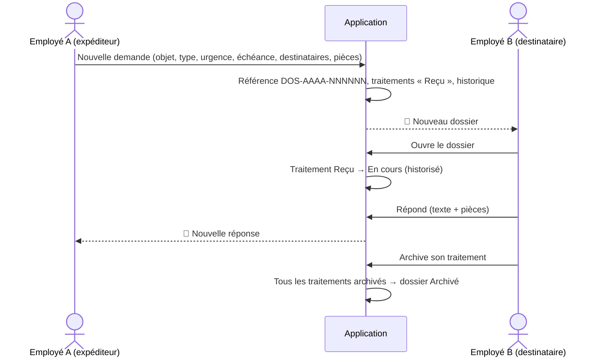
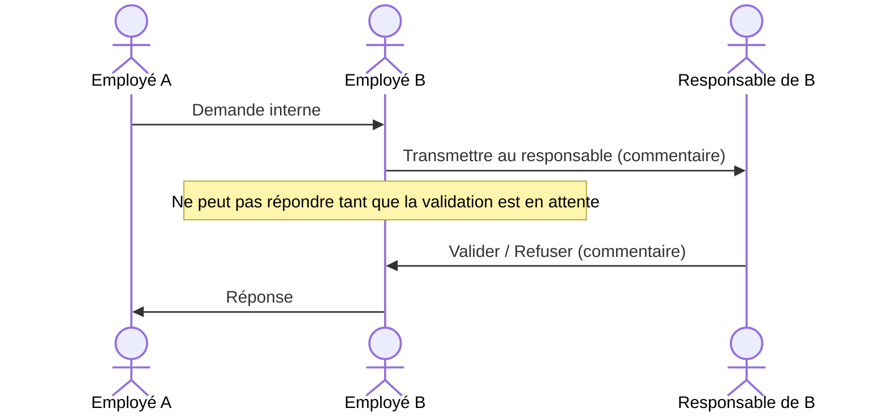
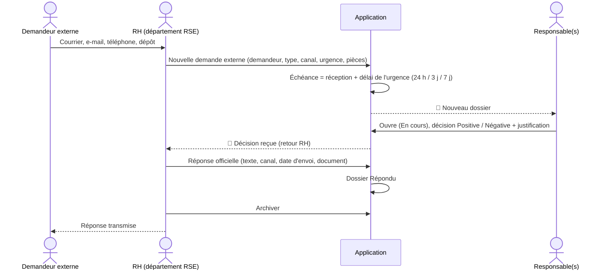

# Workflows métier

## Statuts

| Niveau | Statuts | Remarque |
|---|---|---|
| Dossier (vu par l'expéditeur) | Envoyé → En cours → Répondu → Archivé | déduit des traitements |
| Traitement d'un destinataire | Reçu → En cours → Répondu → Archivé | indépendant pour chaque destinataire |
| Document | Active / Remplacée / Annulée | une seule version active |
| Validation | À valider / Validé / Refusé | sous-étape, le traitement reste « En cours » |

Il n'existe **pas** de statut « En attente » ni « En retard » : un délai dépassé est une **alerte**
(« Statut : En cours — Alerte : délai dépassé »).

## Demande interne

Plusieurs destinataires : chacun suit ce cycle **indépendamment** (ex. Production → Archivé,
RSE → En cours, Administration → Reçu).

**Transmission** : un destinataire peut « Transmettre à un autre utilisateur » ; le collègue reçoit
le dossier avec son propre traitement et une notification.

## Validation hiérarchique

## Demande externe (RH)

Si plusieurs responsables répondent différemment, **toutes les décisions sont conservées** ;
aucune majorité n'est calculée : le RH décide de la réponse officielle.

## Échéances et relances

| Événement | Destinataires de la notification |
|---|---|
| Échéance aujourd'hui | le destinataire |
| Délai dépassé (interne) | le destinataire + l'expéditeur |
| Délai dépassé (externe) | le destinataire + le RH |
| Relance manuelle (« Relancer ») | le destinataire relancé |

La commande `dossiers:check-deadlines` (toutes les heures) n'envoie jamais deux fois la même alerte.

## Archivage et réouverture

- Un dossier archivé est **verrouillé** : plus de modification ni d'ajout ou remplacement de pièce.
- Le responsable du département peut **réouvrir un traitement** répondu ou archivé (motif obligatoire) :
  même numéro, historique intact, le traitement repasse « En cours ».
